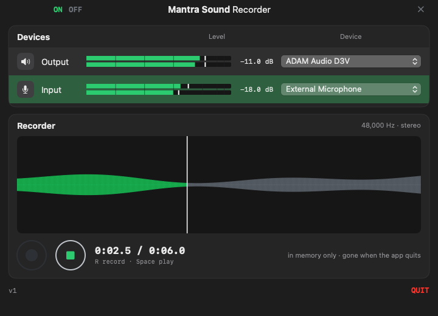

# Mantra Sound Recorder (Mantra)

```sh
git clone https://github.com/markoboskoauroville/MANTRA_SOUND_RECORDER && cd MANTRA_SOUND_RECORDER && ./build.sh
```

A small Swift recorder for the Mac in SoundSource's look: choose the input and the output, watch both on VU meters,
record, play, see the take as a waveform with the playhead running through it. The take lives in memory only and is
gone when the app quits.



- [TAKEOVER.md](TAKEOVER.md): the finished state; read this to continue the work.
- [LESSONS.md](LESSONS.md): what was learned and why things are as they are.
- [momentaryupdates.md](momentaryupdates.md): Marko's requests, word for word, with their status.
